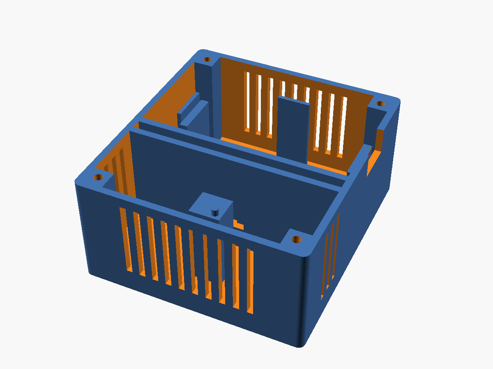

# ESP32 SHT31 Home Assistant Sensor

Temperatur- und Luftfeuchtigkeitssensor für **Home Assistant** auf Basis eines **ESP32 DevKit** und eines **Sensirion SHT31-D**.
Die Firmware ist reine [ESPHome](https://esphome.io)-Konfiguration: kein eigener C++-Code und kein MQTT-Broker. Das Gerät wird in Home Assistant automatisch erkannt.


---

## Funktionen

| Entität           | Einheit | Beschreibung                                  |
|-------------------|---------|-----------------------------------------------|
| Temperatur        | °C      | Messwert des SHT31, geglättet                 |
| Luftfeuchtigkeit  | %       | Relative Luftfeuchtigkeit, geglättet          |
| Taupunkt          | °C      | Berechnet aus Temperatur und Feuchte (Magnus) |
| WLAN-Signal       | dBm     | Diagnose                                      |
| Laufzeit          | s       | Diagnose                                      |
| IP-Adresse        | –       | Diagnose                                      |
| Status            | –       | Online/Offline                                |
| Neustart          | –       | Button zum Neustarten des ESP32               |

Außerdem dabei: automatische Erkennung in Home Assistant ohne Key-Eingabe, Updates über WLAN (OTA) und ein Fallback-Hotspot, falls das WLAN nicht erreichbar ist.

## Hardware

- ESP32 DevKit (z. B. ESP32-WROOM-32 DevKitC)
- SHT31-D Breakout-Board (I²C)
- 4 Jumper-Kabel
- Micro-USB-/USB-C-Kabel und ein 5-V-Netzteil

## Verdrahtung

| SHT31-D | ESP32   |
|---------|---------|
| VIN     | 3V3     |
| GND     | GND     |
| SDA     | GPIO21  |
| SCL     | GPIO22  |
| ADR     | frei → Adresse `0x44` |

```
 SHT31-D            ESP32 DevKit
 ┌──────┐          ┌────────────┐
 │ VIN  ├──────────┤ 3V3        │
 │ GND  ├──────────┤ GND        │
 │ SCL  ├──────────┤ GPIO22     │
 │ SDA  ├──────────┤ GPIO21     │
 └──────┘          └────────────┘
```

> **Tipp:** Den Sensor mit ein paar Zentimetern Abstand zum ESP32 montieren. Der ESP32 erwärmt sich im Betrieb, und direkt daneben misst der Sensor sonst zu hohe Temperaturen.

## Gehäuse



3D-druckbares Gehäuse für die Wandmontage, 66 × 73 × 35 mm. Die STL-Dateien liegen in [`enclosure/`](enclosure).

- **Zwei getrennte Kammern:** Der ESP32 sitzt oben, der Sensor unten. Dazwischen liegt eine doppelte Wand mit Luftspalt, damit die Abwärme des ESP32 die Messung nicht verfälscht.
- **Belüftung:** Die Sensorkammer hat Schlitze an drei Seiten und im Deckel, die ESP32-Kammer gibt ihre Wärme nach oben ab.
- **Kabel:** Unter dem ESP32 ist 24 mm Platz für Dupont-Stecker und Kabelreserve (ausgelegt auf 30-cm-Jumper-Kabel). Die Kabel laufen durch eine Durchführung in der Trennwand.
- **Halterung:** Der ESP32 liegt auf Auflagen und wird vom Deckel niedergehalten. Der SHT31 sitzt auf einem Sockel mit Zentrierstift im Befestigungsloch.
- **Montage:** Der Deckel wird mit 4 × M3×10 Blechschrauben befestigt, an die Wand kommt das Gehäuse über 2 Schlüssellöcher. USB-C ist rechts zugänglich.

| Teil        | Datei                     | Ausrichtung                    |
|-------------|---------------------------|--------------------------------|
| Unterteil   | `enclosure/base.stl`      | Rückwand aufs Druckbett        |
| Deckel      | `enclosure/lid.stl`       | Außenseite aufs Druckbett      |

**Druckeinstellungen:** PLA oder PETG, 0,2 mm Schichthöhe, 3 Wände, 15 % Infill, ohne Stützstrukturen.

**Zusammenbau:**
1. Die 4 Jumper-Kabel durch die Kabeldurchführung fädeln und an den SHT31 stecken.
2. Den SHT31 mit der Bauteilseite nach oben auf den Sockel setzen, mit dem Loch über dem Zentrierstift. Die Stiftleiste zeigt dabei zur Trennwand.
3. Die Kabelreserve locker in der ESP32-Kammer aufrollen, die Kabel an den ESP32 stecken und ihn auf die Auflagen legen (USB-C nach rechts).
4. Den Deckel aufschrauben.

Alle Maße sind in [`enclosure/enclosure.scad`](enclosure/enclosure.scad) als Parameter hinterlegt. Weicht dein Board ab, passt du sie dort in [OpenSCAD](https://openscad.org) an und exportierst die STLs neu.

## Installation

Die Konfiguration braucht nur `wifi_ssid` und `wifi_password` aus den ESPHome-Secrets. Beides legt ESPHome beim ersten Gerät automatisch an, danach musst du nichts mehr eintragen.

### Variante A: ESPHome Add-on in Home Assistant (empfohlen)

1. *Einstellungen → Add-ons → ESPHome Device Builder* installieren und öffnen
2. **+ New Device** → Name `esp32-sht31` → **ESP32** → **Skip**
3. Beim neuen Gerät auf **Edit** klicken, den gesamten Inhalt durch `esp32-sht31.yaml` ersetzen und speichern
4. ESP32 per USB an den PC anschließen → **Install → Plug into this computer** (nur beim ersten Mal, danach per WLAN)
5. Home Assistant meldet *Neues Gerät gefunden* → **Hinzufügen**

### Variante B: ESPHome CLI

```bash
git clone https://github.com/techgaisi-lab/esp32-sht31-homeassistant.git
cd esp32-sht31-homeassistant
cp secrets.example.yaml secrets.yaml   # WLAN eintragen
pip install esphome
esphome run esp32-sht31.yaml
```

Danach erscheint das Gerät in Home Assistant unter *Einstellungen → Geräte & Dienste* und lässt sich mit einem Klick hinzufügen.

> **Hinweis:** Die API ist bewusst ohne Verschlüsselung konfiguriert, damit keine Key-Eingabe nötig ist. Im privaten Heimnetz ist das unkritisch. Wer Verschlüsselung möchte, ergänzt unter `api:` einen `encryption: key:`.

## Konfiguration

Die wichtigsten Einstellungen stehen gesammelt oben in `esp32-sht31.yaml` unter `substitutions`:

| Variable          | Standard       | Beschreibung                          |
|-------------------|----------------|---------------------------------------|
| `device_name`     | `esp32-sht31`  | Hostname im Netzwerk                  |
| `friendly_name`   | `Raumklima`    | Anzeigename in Home Assistant         |
| `update_interval` | `30s`          | Messintervall                         |
| `i2c_sda`         | `GPIO21`       | SDA-Pin                               |
| `i2c_scl`         | `GPIO22`       | SCL-Pin                               |
| `sht31_address`   | `0x44`         | `0x45`, wenn ADR auf 3V3 liegt        |

Für **mehrere Sensoren** einfach die YAML-Datei kopieren und `device_name` sowie `friendly_name` ändern, zum Beispiel `sht31-wohnzimmer` und `sht31-schlafzimmer`.

**Kalibrierung:** Weicht ein Wert von einem Referenzthermometer ab, kannst du ihn über den `offset`-Filter beim jeweiligen Sensor korrigieren.

## Fehlerbehebung

| Problem                                | Lösung                                                                 |
|----------------------------------------|------------------------------------------------------------------------|
| `Communication failed` / Werte `NaN`   | SDA und SCL vertauscht? Im Log nach dem I²C-Scan suchen (`Found i2c device at address 0x44`). |
| Nur Adresse `0x45` gefunden            | `sht31_address: "0x45"` setzen                                          |
| Temperatur zu hoch                     | Sensor weiter vom ESP32 entfernt montieren oder `offset` anpassen       |
| Gerät nicht in Home Assistant sichtbar | ESP32 und Home Assistant im selben Netz? Logs prüfen: `esphome logs esp32-sht31.yaml` |
| WLAN nicht erreichbar                  | Mit dem Hotspot `Raumklima Fallback` verbinden und WLAN neu eintragen   |

## Projektstruktur

```
.
├── esp32-sht31.yaml        # ESPHome-Konfiguration (Firmware)
├── secrets.example.yaml    # Vorlage für Zugangsdaten
├── enclosure/
│   ├── enclosure.scad      # Parametrisches Gehäuse (OpenSCAD)
│   ├── base.stl            # Unterteil
│   ├── lid.stl             # Deckel
│   └── preview-base.png
├── .gitignore              # schließt secrets.yaml und Build-Dateien aus
├── LICENSE
└── README.md
```

## Lizenz

[MIT](LICENSE) © 2026 Lorenz Gaishofer
